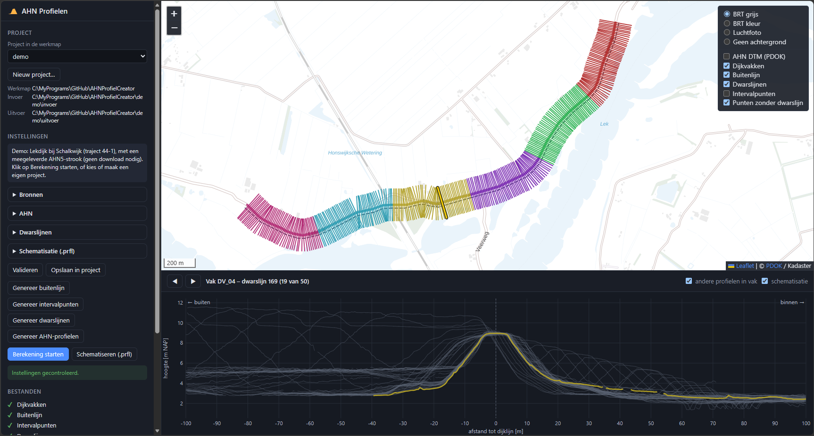

# AHNProfielCreator

Genereert AHN-hoogteprofielen dwars op een dijktraject, per dijkvak. Optioneel maakt de app per dijkvak één
geschematiseerd profiel (`.prfl`) voor Hydra-NL/HydraRing. Er is een webapp om de invoer en uitvoer op een 
kaart te bekijken en de berekening te starten. Rekenen kan ook vanaf de commandline of vanuit Python.

```
dijkvakken (.shp) ─┬─> 1. buitenlijn          buitenlijn_offset.shp   (alleen als die afgeleid wordt)
                   ├─> 2. intervalpunten      cross_points.shp        (elke interval_length m)
                   ├─> 3. dwarslijnen         cross_lines.shp         (beginnen aan de buitenzijde)
AHN-tiffs ─────────┴─> 4. AHN-profielen       cross_lines_ahn.shp     (3D-lijnen met hoogtes)
                       5. schematiseren       prfl/<vak>.prfl         (optioneel)
```



## Inhoud

- [Snel starten (demo)](#snel-starten-demo)
- [Installatie](#installatie)
- [Invoer](#invoer): [dijkvakken](#dijkvakken), [buitenlijn](#buitenlijn), [AHN-data](#ahn-data), [instellingen](#instellingen)
- [Gebruik](#gebruik): [webapp](#webapp), [commandline](#commandline), [Python](#python), [schematiseren](#schematiseren-prfl)
- [Uitvoer](#uitvoer)
- Verder: [methode van de schematisatie](docs/schematisatie.md), [ontwikkelen en testen](CONTRIBUTING.md), [licentie](#licentie)

## Snel starten (demo)

Nodig: [Miniforge](https://conda-forge.org/download/) of een andere conda en (voor het schematiseren) 
internet bij het aanmaken van de omgeving.

1. Haal de code op en ga naar de ontwikkelmap (de map met `src`):

   ```bash
   git clone https://github.com/MariovdBerg/AHNProfielCreator.git
   ```

   ```bash
   cd AHNProfielCreator
   ```

2. Maak de conda-omgeving aan (eenmalig, een paar minuten) en activeer die:

   ```bash
   conda env create -f environment.yml
   ```

   ```bash
   conda activate ahnprofielcreator
   ```

3. Start de demo, op een van drie manieren:

   - **Webapp:** dubbelklik op `start_app.bat`. De browser opent op <http://127.0.0.1:8050/> met het project
     `demo` op de kaart. Klik *Berekening starten* en daarna *Schematiseren (.prfl)*, en klik op een dwarslijn
     voor het profiel. De uitvoer komt in `demo\uitvoer\`.
   - **Commandline:** installeer het pakket en reken met de instellingen van de demo:

     ```bash
     python -m pip install -e .
     ```

     ```bash
     ahn-profielen --config demo\config.ini --schematiseren
     ```

     De uitvoer komt in `demo\uitvoer\`.
   - **Python**: na `python -m pip install -e .`:

     ```python
     from ahnprofielcreator import Settings, run, schematise
     from ahnprofielcreator.demo import demo_config
     
     settings = Settings(**demo_config())
     run(settings)
     schematise(settings)
     ```
     De uitvoer komt in `demo\uitvoer\`.

De berekening duurt enkele seconden. Op de commandline eindigt de log met:

```text
Klaar, output in '...\demo\uitvoer'.
Schematiseren: één Hydra-NL profiel (.prfl) per vak, kwantiel 0.2...
Vak DV_01: 0 berm(en), voorland 3 punten, kruin 8.97 m NAP, RMSE 0.08 m.
...
Klaar: 6 van 6 vakken geschematiseerd (6 zonder fouten), output in '...\demo\uitvoer\prfl'.
```

In de uitvoermap staan dan de afgeleide buitenlijn, 300 intervalpunten, 300 dwarslijnen met AHN-hoogtes en per
vak een `.prfl`-bestand; zie [Uitvoer](#uitvoer) voor wat er in elk bestand staat.


Voor een eigen traject: maak een project in de werkmap (in de webapp met *Nieuw project…*), zet je
dijkvakken in de map `invoer` en vul de instellingen in; zie [Werkmap en projecten](#werkmap-en-projecten) en
[Invoer](#invoer).

## Installatie

Maak eenmalig de conda-omgeving aan (certifi, fiona, rasterio, shapely, numpy, tqdm, pytest en `prflcheck`
voor het schematiseren):

```bash
conda env create -f environment.yml
```

Bestaat de omgeving al, installeer `prflcheck` ([ProfielCheckPython](https://github.com/MariovdBerg/ProfielCheckPython),
niet op PyPI) dan los, in de geactiveerde omgeving. Zonder `prflcheck` werkt alles behalve het schematiseren.
Gebruik `python -m pip`: een losse `pip` kan die van een andere Python zijn, en dan komt het pakket buiten de
omgeving terecht (bijv. in `%APPDATA%\Python`). De versie ligt vast op v2.0.0, omdat de schematisatie de
grenzen van de controle uit `prflcheck` gebruikt.

```bash
python -m pip install https://github.com/MariovdBerg/ProfielCheckPython/archive/refs/tags/v2.0.0.zip
```

Voor de webapp via `start_app.bat` is dit genoeg. Voor het commando `ahn-profielen` of gebruik vanuit eigen
scripts installeer je daarna nog het pakket, in die omgeving en vanuit de ontwikkelmap:

```bash
python -m pip install -e .
```

**Activeer de omgeving altijd** (`conda activate ahnprofielcreator`) voordat je Python, `ahn-profielen` of
`pytest` start; `start_app.bat` doet dat zelf. Roep je `python.exe` uit de omgeving direct aan zonder te
activeren, dan vindt Windows de DLL's van numpy, GDAL en PROJ niet (die staan in `Library\bin`). Python
stopt dan zonder melding, of met een fout zoals `Windows fatal exception: code 0xc06d007f`, of
`Cannot find ... (GDAL_DATA is not defined)`. Dat geldt ook voor een IDE: kies daar de interpreter van
de conda-omgeving (bijv. in VS Code via *Python: Select Interpreter*), zodat die de omgeving activeert.

## Werkmap en projecten

De app werkt in een **werkmap** met **projecten**. Een project is een map in de werkmap met de invoer, de
uitvoer en de instellingen:

```text
<werkmap>\
├─ ahn_data\            gedownloade AHN-bladen (per versie en product), gedeeld door alle projecten
├─ demo\                het meegeleverde demotraject
│  ├─ config.ini        instellingen van het project
│  ├─ invoer\           dijkvakken, (eventueel) buitenlijn en lokale AHN-tiffs (in AHN\AHN5\DTM05)
│  └─ uitvoer\          resultaat van de berekening en de schematisatie
└─ <eigen project>\
   ├─ config.ini
   ├─ invoer\
   └─ uitvoer\
```

- **Werkmap:** standaard de map waarin je de app start. `start_app.bat` start in de ontwikkelmap (de map met
  `src`), zodat `demo` daar een van de projecten is; een eigen werkmap kan een `.bat` krijgen dat ernaar
  verwijst (zie [Webapp](#webapp)).
- **Projectmap:** de map van het project, met de mappen `invoer` en `uitvoer`. Niet te verwarren met de
  git-projectmap waarin ontwikkeld wordt.
- **Invoer:** relatieve paden in de instellingen gelden ten opzichte van `invoer`, bijv.
  `input_line = dijkvakken.shp` of `ahn_file_loc = AHN` (de AHN-map is `invoer\AHN`). Absolute paden
  (bijv. `D:\AHN`) werken ook.
- **Uitvoer:** alles komt in `uitvoer`. Een nieuwe berekening overschrijft de vorige, ook met een ander interval.

## Invoer

Wat je aanlevert, in het kort:

| Invoer | Verplicht | Instelling |
|---|---|---|
| Dijkvakken: lijnen, één per vak | ja | `input_line`, `group_id` |
| Buitenlijn: geeft aan welke kant buiten ligt | nee, maar nodig voor de richting van de dwarslijnen en voor het schematiseren; kan ook afgeleid worden | `input_line_outside` of `outside_offset` + `outside_side` |
| AHN-tiffs: lokale map; ontbrekende bladen worden gedownload | ja (een map) | `ahn_file_loc`, `ahn_file_downloaded` |
| Project: map met `invoer` en `uitvoer` | ja | de map van `config.ini`, of `projectmap` |

### Dijkvakken

Eén shapefile (`input_line`) met de dijklijn, opgedeeld in dijkvakken:

- **Geometrie:** `LineString` of `MultiLineString`. Gesloten ringen en vakken uit meerdere delen mogen.
  Andere geometrieën (punten, vlakken) worden overgeslagen.
- **Vak-attribuut:** het attribuut `group_id` (standaard `vak_id`) moet bestaan en uniek zijn: één feature per
  vak. De naam komt terug in de uitvoer en als bestandsnaam van het `.prfl`.
- **Traject-attribuut (optioneel):** `traject`, het (norm)traject van het vak. Het `ID` in het `.prfl` wordt dan
  `{traject}_{vak}` (bijv. `44-1_DV_01`), anders alleen het vak.
- **Coördinaten:** RD New (EPSG:28992, of RD + NAP, EPSG:7415), met een `.prj`-bestand. Een ander stelsel of een
  ontbrekende `.prj` geeft een foutmelding en er wordt niets berekend. Herprojecteer het bestand dan eerst, bijv.
  in QGIS (*Vector › Data Management Tools › Reproject Layer*), of ken RD New toe als de coördinaten al in RD
  staan maar de `.prj` ontbreekt.
- **Ligging:** de lijn ligt het best op of bij de kruin. De afstand in de profielen is de afstand tot deze lijn.
- **Lengte:** elk vak moet langer zijn dan de intervalafstand (`interval_length`), anders krijgt het geen punten.
- **Tekenrichting:** maakt alleen uit als de buitenlijn wordt afgeleid (zie hieronder).
- Overige attributen worden overgenomen in de uitvoer.

### Buitenlijn

De buitenlijn bepaalt alleen aan welke kant van de dijklijn de buitenzijde ligt: dwarslijnen worden zo gedraaid
dat ze aan de buitenkant beginnen. Zonder buitenlijn blijft de richting van de dwarslijnen onbepaald en kan er
niet geschematiseerd worden. Er zijn twee manieren:

1. **Opgeven** (`input_line_outside`): een lijn-shapefile in RD New aan de buitenzijde, bijv. de waterlijn of de
   buitenteen. Heeft de buitenlijn het vak-attribuut (`group_id`), dan wordt
   per vak de eigen buitenlijn gebruikt; dan moet elk vak er een hebben.
2. **Afleiden** (zoals "Offset Curves" in QGIS): laat `input_line_outside` leeg en zet `outside_offset` op een
   afstand in meters, bijv. `20`. De dijkvakken worden dan zoveel naar links of rechts (`outside_side`) van hun
   tekenrichting verschoven en weggeschreven als `buitenlijn_offset.shp` in de uitvoermap. Het demotraject werkt
   zo. 

Let op bij van de buitenlijn (zowel *Opgeven* als bij *Afleiden*):
   - De afstand moet kleiner zijn dan de halve `cross_length`, anders snijden de dwarslijnen de lijn niet.
   - Links/rechts is ten opzichte van de richting waarin elk dijkvak getekend is. Zijn de vakken niet
     allemaal in dezelfde richting getekend, dan ligt de afgeleide buitenlijn bij sommige vakken aan de
     verkeerde kant. Controleer dat op de kaart in de webapp (knop *Genereer buitenlijn*).
   - Een intervalpunt waarvan de dwarslijn de buitenlijn niet snijdt, krijgt geen dwarslijn; de webapp toont zulke
punten in rood.

### AHN-data

De hoogtes worden uit **lokale** AHN GeoTIFF's gelezen. Ontbrekende kaartbladen downloadt de app zelf.

1. **AHN-map** (`ahn_file_loc`): hier zoekt de app de tiffs, bijv. `D:\AHN`. De AHN-map heeft een vaste
   opbouw (zie hieronder).
2. **Map voor downloads** (`ahn_file_downloaded`, optioneel): hier komen gedownloade bladen en hier wordt ook
   gezocht, met dezelfde opbouw. Leeg = `ahn_data` in de werkmap, zodat alle projecten dezelfde downloads
   gebruiken.
3. **Kaartbladindex** (`ahn_index`, standaard de meegeleverde `bladwijzer.gpkg` in `src/ahnprofielcreator/data`):
   de bladwijzer van AHN met de kaartbladen van 5 × 6,25 km en per blad downloadlinks per AHN-versie en product
   ([bron](https://basisdata.nl/hwh-ahn/AUX/bladwijzer.gpkg), [kaart](https://basisdata.nl/hwh-ahn/AUX/bladwijzer/index.html)).
   De bladnaam staat in attribuut `AHN` (`ahn_index_id`). Een eigen index (.gpkg of .shp, RD New) mag ook, als
   die dezelfde velden heeft.

Welke AHN-data gebruikt wordt, kies je zelf:

| Instelling | Standaard | Mogelijk |
|---|---|---|
| `ahn_versie` | `5` | 1 t/m 5 (met terugval op 4 voor versies boven 4) |
| `model` | `DTM` | `DTM` (maaiveld) of `DSM` (oppervlakte) |
| `model_resolutie` | `0.5` | `0.5` of `5` [m] |

De werkwijze per kaartblad dat de dwarslijnen raakt:

1. Zoek in `AHN<versie>\<product>` van `ahn_file_loc` en `ahn_file_downloaded` de tiff met de naam uit de downloadlink,
   bijv. `2023_M_01CZ1.TIF` (AHN5) of `M_01CZ1.TIF` (AHN4, uit `M_01CZ1.zip`).
   Hoofd-/kleine letters maken niet uit en een extra achtervoegsel mag, zodat ook `M_01CZ1_DEFLATE.tif` gevonden wordt.
2. Niet gevonden: download het blad naar `ahn_file_downloaded` (AHN4-zips worden uitgepakt). Bij 0,5 m is dat
   ~200 MB per blad.
3. Heeft het blad geen (werkende) link voor de gekozen versie, dan valt de app terug op AHN4, dat
   heel Nederland dekt. AHN5 wordt sinds 2023 in drie jaar ingewonnen ([voortgang](https://www.ahn.nl/voortgang-ahn5-2023)).
   De terugval staat als waarschuwing in de log.

Bladen zonder tiff worden met een waarschuwing overgeslagen; in de webapp kun je de dwarslijnen op
AHN-dekking kleuren om dat te zien. Heeft minstens de helft van de punten op een blad geen hoogte, dan
staat dat als waarschuwing in de log. Dat kan water zijn, maar ook een AHN5-blad dat nog maar deels
ingewonnen is (bijv. 40BZ2: het blad bestaat, maar bevat 0,1% data ten tijde van ontwikkeling).
De app valt dan niet terug op AHN4; kies zo nodig zelf `ahn_versie = 4`.

**Opbouw van de AHN-map.** Per AHN-versie een map (`AHN1` t/m `AHN6`) en daarin per product een map:
`DTM05`, `DTM5`, `DSM05` of `DSM5` (DTM/DSM, 0,5 m/5 m). De tiffs staan in de productmap:

```text
D:\AHN\                      ahn_file_loc = D:\AHN
├─ AHN4\
│  └─ DTM05\M_01CZ1.TIF
└─ AHN5\
   ├─ DTM05\2023_M_01CZ1.TIF
   └─ DSM5\...
```

De app kiest zelf de map bij `ahn_versie`, `model` en `model_resolutie`; bij terugval op AHN4 zoekt hij in
`AHN4\<product>`. Zo raken tiffs van AHN3 en AHN4, die dezelfde bestandsnamen hebben, niet door elkaar.
Bij de start controleert de app de opbouw van de AHN-map en de downloadmap en stopt met een foutmelding bij
losse tiffs direct in de map of in een versiemap, of bij andere mappen dan deze versie- en productmappen (andere
bestanden, bijv. een leesmij, mogen). Wijst `ahn_file_loc` nog naar een productmap zoals `D:\AHN\AHN5\DTM05`
(de opbouw van vóór deze controle), dan noemt de melding de map die het moet zijn. Gedownloade bladen uit een
oudere versie van de app staan los in `ahn_data`: verplaats ze naar de juiste `AHN<versie>\<product>`-map of
verwijder ze (ze worden dan opnieuw gedownload).

**Let op:**
- AHN6 gebruikt bladen van 1 × 1 km en zit niet in `bladwijzer.gpkg`. Met `bladwijzer_AHN6.gpkg` (ook
  meegeleverd, de AHN6-bladindeling van [AHN](https://www.ahn.nl)) controleert de app wel of AHN6 langs het traject al te downloaden is en meldt dat in de log;
  voor de berekening gebruikt de app AHN6 (nog) niet.

Licentie: AHN1 t/m AHN4 vallen onder CC0, AHN5 en later onder CC BY 4.0 (bronvermelding: AHN).
De downloads gebruiken de certificaten van `certifi`, omdat de Windows-certificaatopslag een
verlopen tussencertificaat kan bevatten; lukt dat niet, dan die van Windows.

### Instellingen

De instellingen van een project staan in `config.ini` in de projectmap. In de webapp pas je ze aan en sla je
ze op met *Opslaan in project*; met de hand kun je `config.example.ini` kopiëren naar `<project>\config.ini`.
Alle instellingen staan in de sectie `[profielen]`; paden schrijf je zonder aanhalingstekens en een lege
waarde betekent de standaardwaarde. Commentaar begint met `;`.

Een `config.ini` die de app schrijft (bij *Nieuw project…* en bij *Opslaan in project*) bevat **alle**
instellingen, ook die op de standaardwaarde staan, met per instelling een regel uitleg. Zo is altijd te zien
welke waarden gebruikt zijn. Alleen `ahn_index` blijft leeg als je de meegeleverde `bladwijzer.gpkg` gebruikt
(het pad daarvan hangt af van de installatie), en `ahn_file_downloaded` staat standaard op `..\..\ahn_data`
(`ahn_data` in de werkmap, gezien vanuit `invoer`). `demo\config.ini` en `config.example.ini` zijn ook zo
gemaakt. Eigen commentaar in het bestand gaat bij opslaan vanuit de app verloren.

Relatieve paden naar invoer gelden ten opzichte van de map `invoer` van het project (zie
[Werkmap en projecten](#werkmap-en-projecten)). De projectmap zelf staat niet in het bestand: dat is de map
van `config.ini`. Een oud bestand met `cur_dir` geeft een foutmelding; verplaats het naar een projectmap en
haal `cur_dir` weg.

| Instelling | Standaard | Betekenis |
|---|---|---|
| `projectmap` | de map van `config.ini` | projectmap met `invoer` en `uitvoer`; alleen nodig vanuit Python of met `--projectmap` |
| `input_line` | (verplicht) | shapefile met de dijkvakken |
| `group_id` | `vak_id` | vak-attribuut in de dijkvakken (en eventueel de buitenlijn) |
| `input_line_outside` | leeg | shapefile met de buitenlijn |
| `outside_offset` | leeg (= niet afleiden) | [m] zonder buitenlijn: leid die af door de dijkvakken zoveel te verschuiven |
| `outside_side` | `links` | kant van de afgeleide buitenlijn t.o.v. de tekenrichting: `links` of `rechts` |
| `ahn_file_loc` | (verplicht) | AHN-map met `AHN<versie>\<product>`-mappen met lokale tiffs |
| `ahn_file_downloaded` | leeg (= `<werkmap>\ahn_data`) | map voor gedownloade bladen |
| `ahn_versie`, `model`, `model_resolutie` | `5`, `DTM`, `0.5` | welke AHN-data; zie [AHN-data](#ahn-data) |
| `ahn_index`, `ahn_index_id` | `bladwijzer.gpkg`, `AHN` | kaartbladindex met downloadlinks |
| `interval_length` | `10` | [m] afstand tussen de dwarslijnen langs elk vak |
| `cross_length` | `200` | [m] lengte van een dwarslijn, de helft aan elke kant van de dijklijn |
| `ahn_stepsize` | `0.5` | [m] afstand tussen de hoogtepunten langs een dwarslijn |
| `schem_*` | | instellingen van het schematiseren; zie [docs/schematisatie.md](docs/schematisatie.md#instellingen) |

## Gebruik

### Webapp

Een lokale webapp om invoer en uitvoer te bekijken en de berekening te starten. Installeren van
het pakket is niet nodig: dubbelklik op `start_app.bat`. Dat activeert de conda-omgeving
`ahnprofielcreator`, start de app met de ontwikkelmap als werkmap en het project `demo` (het
[demotraject](#snel-starten-demo)) geopend, en opent de browser op <http://127.0.0.1:8050/>. Stoppen: sluit
het venster of druk Ctrl+C.

**Starten vanuit een eigen werkmap.** Werk je met projecten buiten de repository, maak dan in die werkmap
een eigen `.bat` dat naar `start_app.bat` in de repository verwijst:

1. Maak in de werkmap (bijv. `D:\Projecten\Dijkversterking`) een tekstbestand `start_app.bat`.
2. Zet er deze ene regel in, met het pad naar jouw checkout van de repository:

   ```bat
   @call "C:\MyPrograms\GitHub\AHNProfielCreator\start_app.bat" "%~dp0."
   ```

3. Dubbelklik erop. De app start met de map van dit `.bat`-bestand als werkmap en toont de projecten
   daarin; de code komt uit de repository. Er is nog geen project geopend (tenzij de werkmap een map
   `demo` heeft): kies er een onder *Project* of maak er een met *Nieuw project…*.

`%~dp0.` is de map van het `.bat`-bestand, waar je het ook start. Een andere conda-omgeving kies je met
een regel `set "AHN_ENV=naam"` boven de `@call`-regel. Gedownloade AHN-bladen komen in `ahn_data` in de werkmap.

Verder:

- **Ander project:** kies het in de app onder *Project*, of maak er een met *Nieuw project…* (maakt de mappen
  `invoer` en `uitvoer` en een volledige `config.ini` met de standaardwaarden). Of sleep de `config.ini` van een project op `start_app.bat`.
- **Andere werkmap eenmalig:** sleep de map op `start_app.bat`, of `start_app.bat pad\naar\werkmap`.
- Andere conda-omgeving: pas `AHN_ENV` bovenin `start_app.bat` aan (of zet de omgevingsvariabele `AHN_ENV`).

Zonder het `.bat`-bestand, in een geactiveerde omgeving:

```bash
python app.py --werkmap pad\naar\werkmap --project naam
```

Zonder `--werkmap` is de huidige map de werkmap; zonder `--project` opent de app `demo` als dat er is.
`--config <project>\config.ini` opent dat project met de map erboven als werkmap. Andere poort: `--port`.
Na `python -m pip install -e .` werkt ook `ahn-profielen-app`.

Wat de app laat zien:

- **Kaart:** dijkvakken, buitenlijn, intervalpunten en dwarslijnen. Punten waarvoor geen dwarslijn
  gemaakt kon worden (geen snijpunt met de buitenlijn) staan in rood. Dwarslijnen kunnen per vak of
  op AHN-dekking gekleurd worden, zodat ontbrekende AHN-tegels opvallen.
- **Profiel:** klik op een dwarslijn voor het hoogteprofiel, met de andere profielen uit het vak in
  grijs. Bladeren met ◀ ▶ of de pijltjestoetsen. De x-as is de afstand tot de dijklijn; met een
  buitenlijn staat de buitenzijde links.
- **Project:** kies een project uit de werkmap of maak een nieuw; daaronder staan de werkmap en de mappen
  `invoer` en `uitvoer` van het project.
- **Instellingen:** aanpassen en *Valideren* controleert ze en toont de bestanden bij die instellingen
  (de instellingen gelden dan voor de app, maar staan nog niet in een bestand). *Opslaan in project*
  valideert en slaat alle instellingen (ook de standaardwaarden) op in `config.ini` van het project; het
  formulier toont daarna wat er in het bestand staat.
- **Stappen:** *Berekening starten* voert alle stappen uit (behalve het schematiseren) en laadt daarna het
  resultaat. Elke stap kan ook los: *Genereer buitenlijn* (alleen zonder opgegeven buitenlijn en met een
  afstand), *Genereer intervalpunten*, *Genereer dwarslijnen* en *Genereer AHN-profielen*. Een stap
  gebruikt de uitvoer van de vorige; de knop is pas actief als die er is. Pas je bijv. de lengte van de
  dwarslijnen aan, genereer dan ook de stappen daarna opnieuw.
- **Schematiseren (.prfl):** na de berekening; daarna toont de profielgrafiek per vak ook het representatieve
  profiel (gestippeld), het Hydra-NL profiel (oranje) en het voorland (groen), met het aantal bermen en de
  uitkomst van de controle. Is de berekening daarna opnieuw gedaan, dan staat de schematisatie als *verouderd*
  bij de bestanden.

De app gebruikt alleen de standaardbibliotheek en fiona (en `prflcheck` voor het schematiseren). Leaflet staat in
`src/ahnprofielcreator/app/static/vendor/leaflet`. Van internet komen de achtergrondkaarten (BRT,
luchtfoto, AHN, via PDOK) en, tijdens de berekening, ontbrekende AHN-kaartbladen (via basisdata.nl).
Zonder internet werkt de app ook, maar zonder achtergrond en alleen met tiffs die al lokaal staan.
De app is alleen bereikbaar vanaf de eigen computer (127.0.0.1).

### Commandline

Na `python -m pip install -e .`, in een geactiveerde omgeving:

```bash
ahn-profielen --config pad\naar\project\config.ini
```

De projectmap is de map van `config.ini` (of geef `--projectmap`). Losse opties overschrijven de waarden uit het configuratiebestand, bijv. `--interval-length 25`. Met
`--schematiseren` volgt daarna het schematiseren. Zie `ahn-profielen --help` voor alle opties.
`python -m ahnprofielcreator` werkt ook.

### Python

```python
from ahnprofielcreator import Settings, run, schematise

settings = Settings(
    projectmap=r"...\werkmap\mijn_project",  # met de mappen invoer en uitvoer
    input_line="dijkvakken.shp",  # relatief t.o.v. invoer
    input_line_outside="buitenlijn.shp",  # of: None en outside_offset=20 om de buitenlijn af te leiden
    outside_side="links",
    group_id="vak_id",
    ahn_file_loc=r"D:\AHN",  # AHN-map met lokale tiffs in AHN5\DTM05 enz.
    ahn_file_downloaded=None,  # map voor downloads; None = <werkmap>\ahn_data
    ahn_versie=5,  # standaard; terugval op AHN4
    model="DTM",
    model_resolutie=0.5,
    interval_length=10,
    cross_length=200.0,
    ahn_stepsize=0.5,
)
run(settings)
schematise(settings)  # optioneel
```

`run` geeft per vak de dwarslijnen met hoogtes terug; de bestanden staan daarna in `settings.output_dir`
(`<projectmap>\uitvoer`).

### Schematiseren (.prfl)

Een optionele stap ná de berekening: per dijkvak één geschematiseerd profiel (`.prfl`, versie 4). In de webapp
met de knop *Schematiseren (.prfl)*, op de commandline met `--schematiseren` en vanuit Python met
`schematise(settings)` na `run(settings)`. Nodig: een buitenlijn (opgegeven of afgeleid) en het pakket `prflcheck`.

Per vak neemt de app een laag kwantiel (standaard 0,2) van alle AHN-profielen als representatief profiel, zoekt
de kruin bij de dijklijn en fit aan de buitenzijde een profiel met voorland, taluds en 0 tot 2 bermen dat voldoet
aan de regels van Hydra-NL/Ringtoets. De werkwijze en alle instellingen staan in
[docs/schematisatie.md](docs/schematisatie.md). Controleer het resultaat altijd: de schematisatie is een
automatisch startpunt, geen vervanging van een beoordeling van het profiel.

## Uitvoer

Alles komt in de uitvoermap van het project, `<projectmap>\uitvoer\` (bijv. `demo\uitvoer`). Alle shapefiles
staan in RD New. Elke stap overschrijft de bestanden van een vorige berekening, ook als de instellingen
(bijv. het interval) anders waren.

| Bestand | Inhoud |
|---|---|
| `buitenlijn_offset.shp` | afgeleide buitenlijn, één lijn per vak met de attributen van de dijkvakken (alleen bij `outside_offset`) |
| `cross_points.shp` | intervalpunten op de dijkvakken, elke `interval_length` m vanaf het begin van elk vak |
| `cross_lines.shp` | dwarslijnen door de intervalpunten, lengte `cross_length` |
| `cross_lines_ahn.shp` | dezelfde dwarslijnen als 3D-lijn met AHN-hoogtes: het eigenlijke resultaat |
| `prfl\<vak>.prfl` | geschematiseerd profiel per vak (na het schematiseren) |
| `prfl\schematisatie.csv` | overzicht van de schematisatie per vak |
| `prfl\schematisatie.json` | hetzelfde overzicht met de profielen, voor de webapp |

### Attributen van de shapefiles

Alle attributen van de dijkvakken (zoals `vak_id`) worden overgenomen. Daarbij komen:

| Attribuut | In | Betekenis |
|---|---|---|
| `POINT_ID` | punten, dwarslijnen, AHN-profielen | volgnummer van het intervalpunt over het hele traject |
| `CROSS_ID` | dwarslijnen, AHN-profielen | volgnummer van de dwarslijn (en het AHN-profiel) over het hele traject; wijkt af van `POINT_ID` zodra er dwarslijnen zijn overgeslagen omdat ze de buitenlijn niet snijden |
| `mid_x`, `mid_y` | dwarslijnen | RD-coördinaten van het intervalpunt (het snijpunt met de dijklijn) |
| `angle` | dwarslijnen | richting van de dijklijn naar de buitenzijde, in graden t.o.v. noord (met de klok mee); leeg zonder buitenlijn |
| `LEFTRIGHT`, `TOPBOTTOM` | dwarslijnen | of de lijn van west naar oost resp. van noord naar zuid loopt (voor het tekenen) |

### De AHN-profielen lezen

Elke lijn in `cross_lines_ahn.shp` is een 3D-lijn met een punt om de `ahn_stepsize` m (standaard 0,5 m):

- **x, y:** RD-coördinaten; **z:** hoogte in m NAP uit het gekozen AHN-model.
- **Richting:** met een buitenlijn begint de lijn aan de buitenzijde. De afstand tot de dijklijn is dan de
  afstand langs de lijn min de halve `cross_length`: negatief = buiten, positief = binnen.
- **Geen hoogte = `-99999`.** Punten zonder AHN-hoogte (water, een blad zonder tiff, een deels ingewonnen blad)
  krijgen z = -99999. Filter die weg voordat je gaat plotten of rekenen, anders zie je diepe pieken.

Voorbeeld in Python:

```python
import fiona
import numpy as np

with fiona.open(r"demo\uitvoer\cross_lines_ahn.shp") as src:
    for row in src:
        xyz = np.array(row.geometry.coordinates)
        afstand = np.hypot(*(xyz[:, :2] - xyz[0, :2]).T) - 200.0 / 2  # cross_length / 2
        z = np.where(xyz[:, 2] == -99999, np.nan, xyz[:, 2])
        print(row.properties["vak_id"], np.nanmax(z))
```

### Overzicht van de schematisatie

`prfl\schematisatie.csv` heeft één regel per vak, met `;` als scheidingsteken en een decimale komma (voor
Nederlandse Excel; in pandas: `sep=";", decimal=","`):

| Kolom | Betekenis |
|---|---|
| `vak`, `bestand` | vak en naam van het `.prfl`-bestand |
| `traject` | (norm)traject uit het attribuut `traject` van de dijkvakken; leeg als dat attribuut ontbreekt. Een vak moet in één traject liggen: zijn het er meer, dan stopt het schematiseren met een foutmelding |
| `n_profielen` | aantal AHN-profielen in het vak |
| `kruinhoogte` | [m NAP] kruinhoogte in het `.prfl` |
| `richting` | [graden t.o.v. noord] gemiddelde dijknormaal naar buiten |
| `bermen` | aantal bermen in het profiel (0 – 2) |
| `n_dijkpunten`, `n_voorlandpunten` | aantal punten van het dijkprofiel en van het voorland |
| `voorland_verlaagd` | [m] hoeveel het eerste voorlandpunt verlaagd is (laagte of sloot bij de teen) |
| `rmse` | [m] afwijking van het gekozen profiel t.o.v. het representatieve profiel |
| `check` | uitkomst van de controle door `prflcheck`: `0` = goedgekeurd |
| `omschrijving` | toelichting bij de controle, of de foutmelding als het vak niet geschematiseerd kon worden |

## Licentie

Copyright (c) 2026 HKV

AHNProfielCreator valt onder de [European Union Public Licence v1.2](LICENSE) (EUPL-1.2). Meegeleverde
software van derden houdt haar eigen licentie, zoals [Leaflet](src/ahnprofielcreator/app/static/vendor/leaflet/LICENSE)
(BSD-2-Clause). Voor de licentie van de AHN-data zelf, zie [AHN-data](#ahn-data).
